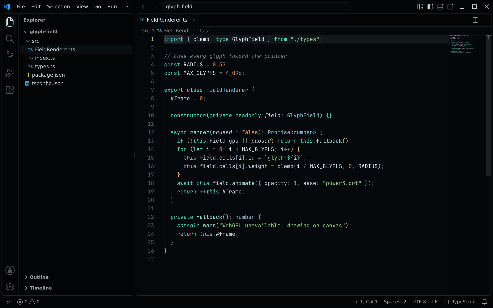
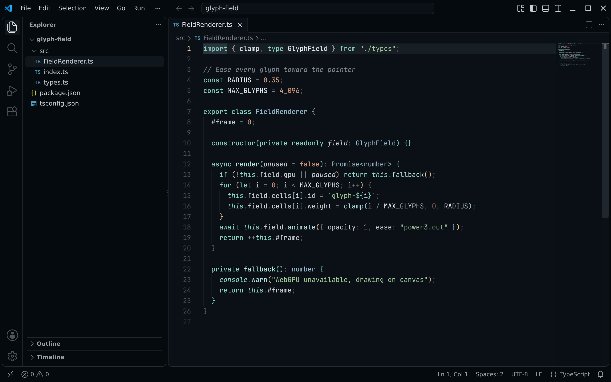
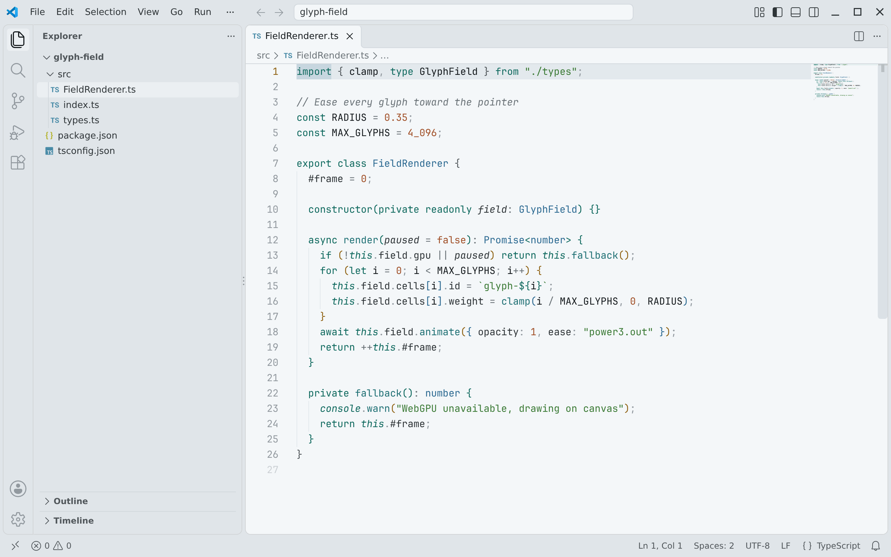
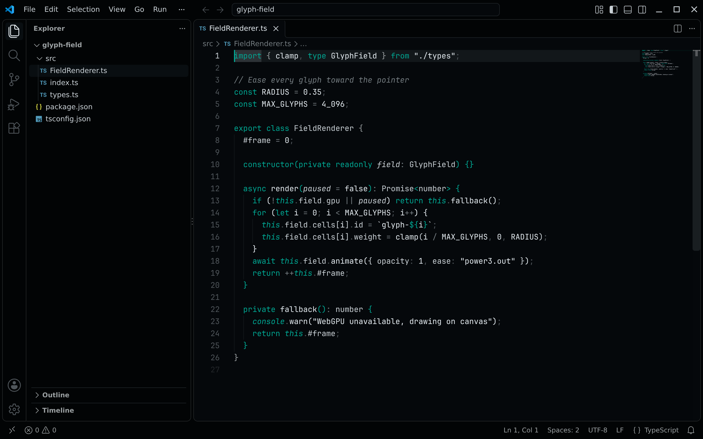

<!-- living-code-readme:1 -->
# 💻 Living Code for VS Code

**Calm slate. Living color.** Living Code for VS Code. Repository-owned theme files, installation instructions and four color flavors.

[Installation](#installation) · [Flavors](#flavors) · [Configuration](#configuration) · [All ports](https://github.com/living-code-theme)

## Previews

<table data-lc-flavors>
<tr>
<td width="50%" valign="top">
<strong>Night</strong><br><sub>Dark · full palette</sub><br><br>
<a href="images/night.png"></a>
</td>
<td width="50%" valign="top">
<strong>Frost</strong><br><sub>Dark · softer chroma</sub><br><br>
<a href="images/frost.png"></a>
</td>
</tr>
<tr>
<td width="50%" valign="top">
<strong>Paper</strong><br><sub>Light · near-white slate</sub><br><br>
<a href="images/paper.png"></a>
</td>
<td width="50%" valign="top">
<strong>Signal</strong><br><sub>Dark · teal accent</sub><br><br>
<a href="images/signal.png"></a>
</td>
</tr>
</table>

Select any preview to view the image at full size.

## Installation

When listed, search **Living Code** under publisher **living-code-theme** in the VS Code Marketplace or Open VSX, install it, then run *Preferences: Color Theme → Living Code Night*. The extension ID is `living-code-theme.living-code`.

**Without a marketplace:** download `living-code-0.1.1.vsix` from the [latest GitHub release](https://github.com/living-code-theme/vscode/releases/latest), or build it from a checkout:

```sh
node scripts/package.mjs
code --install-extension dist/living-code-0.1.1.vsix
```

Choose another Living Code flavor with the color-theme picker.

## Flavors

Expand a flavor for its full-size preview and activation instructions.

<details data-lc-flavor="night">
<summary><strong>Night</strong> · Dark · full palette</summary>

<p><a href="images/night.png"></a></p>

Choose **Living Code Night** in *Preferences: Color Theme*.

</details>

<details data-lc-flavor="frost">
<summary><strong>Frost</strong> · Dark · softer chroma</summary>

<p><a href="images/frost.png"></a></p>

Choose **Living Code Frost** in *Preferences: Color Theme*.

</details>

<details data-lc-flavor="paper">
<summary><strong>Paper</strong> · Light · near-white slate</summary>

<p><a href="images/paper.png"></a></p>

Choose **Living Code Paper** in *Preferences: Color Theme*.

</details>

<details data-lc-flavor="signal">
<summary><strong>Signal</strong> · Dark · teal accent</summary>

<p><a href="images/signal.png"></a></p>

Choose **Living Code Signal** in *Preferences: Color Theme*.

</details>

## Configuration

The extension supplies color themes, not fonts or editor settings. Keep your existing preferences. Use VS Code's `workbench.colorCustomizations` and `editor.tokenColorCustomizations` settings for personal overrides.

## Compatibility

Supports the `engines.vscode` compatibility range in package.json and all four Living Code themes. The same VSIX can be used in compatible VS Code forks. Marketplace updates use the extension ID `living-code-theme.living-code`; installations from another publisher do not switch automatically.

## Contributing

Found a problem? [Open an issue](https://github.com/living-code-theme/vscode/issues/new/choose) with the app version, the flavor and a screenshot. Want Living Code somewhere else? [Request a port](https://github.com/living-code-theme/core/issues/new?template=port-request.yml).

Pull requests are welcome. Keep this README, `port.json` and `images/` in sync, and use real screenshots of the app, never mockups.

🦎 **One chameleon, many habitats.** Part of [Living Code](https://github.com/living-code-theme).

## License

[MIT](LICENSE) © Elliot Luque
